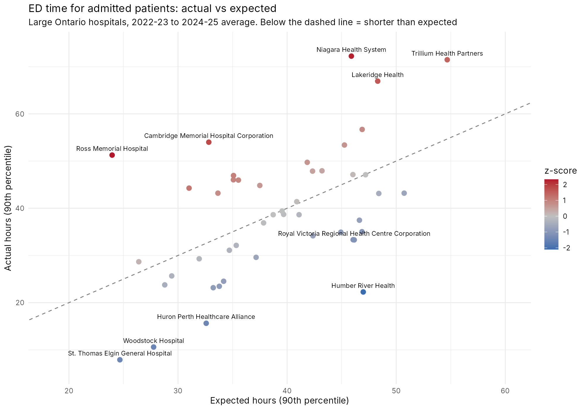

# High ALC, Short ED Waits? A Benchmark of 46 Large Ontario Hospitals

An independent analysis in R of whether Ontario hospitals that carry a heavy alternate level of care (ALC) load still keep emergency department (ED) times short, and what separates the hospitals that beat expectations from those that don't.

The full write-up is in [`docs/High_ALC_Short_ED_Waits_Report.pdf`](docs/High_ALC_Short_ED_Waits_Report.pdf).

## The question

ALC patients are medically ready to leave hospital but are waiting for long-term care, rehab or home care. While they wait, they hold an inpatient bed, so newly admitted patients wait in the ED instead. The project started with one question:

> Which large Ontario hospitals carry a heavy ALC load but still keep ED time for admitted patients short, and what are they doing differently?

## What I found

- **ALC didn't explain which hospitals have long ED times.** Comparing hospitals, each extra point of ALC goes with +0.31 hours of ED time (95% CI −0.24 to +0.86). Comparing each hospital with itself over four years, the effect is +0.40 (CI −0.21 to +1.01). Neither is significant, and the effect drops to zero once region is added.
- **Size mattered most.** Doubling a hospital's acute beds goes with about 8 more hours of ED time (p = 0.002). Raw comparisons penalize large hospitals: 17 of the 18 hospitals with 500+ beds rank better once size and patient mix are accounted for.
- **The gaps are large and stable.** The model explains 26% of the variation between hospitals, and a hospital's gap from its expected time correlates 0.86–0.91 from one year to the next.
- **Standouts:** Humber River runs about 25 hours faster than expected, and Halton cut 21 hours while its ALC rose. Ross Memorial, Niagara, Cambridge, Lakeridge and Trillium run slower than expected.



## Method

| Step | Script | What it does |
|---|---|---|
| 1 | `R/01_clean_merge.R` | Cleans the four CIHI files, matches hospital names across them (including merged corporations), and builds one row per hospital per fiscal year. Keeps hospitals with 100+ acute beds; drops pediatric and specialty hospitals. |
| 2 | `R/02_part_a.R` | **Part A, benchmark (2022–23 to 2024–25).** Regresses ED time (90th percentile, admitted patients) on ALC share, frailty, log acute beds and teaching status, with year effects and standard errors clustered by hospital. Ranks hospitals by their average gap from expected, and checks multicollinearity, influential points, year-to-year persistence and a region control. |
| 3 | `R/03_part_b.R` | **Part B, over time (2022–23 to 2025–26).** Hospital and year fixed effects, so each hospital is compared only with itself. Robustness checks with frailty, last year's ALC, and all 110 hospitals. Flags improvers and decliners. |

A follow-up review of the top and bottom performers' public Quality Improvement Plans is covered in the report.

## How to run

1. Install R (4.3 or later) and, ideally, RStudio.
2. Open `ontario-alc-ed-benchmark.Rproj` in RStudio, or set the working directory to this folder.
3. Run `source("run_all.R")`. It installs any missing packages, then runs the three scripts in order.

Outputs land in `data/clean/` and `output/`. A full run takes under a minute.

Built with R 4.3.3, dplyr 1.1.4, tidyr 1.3.1, readr 2.1.5, readxl 1.4.3, stringr 1.5.1, sandwich 3.1.0, lmtest 0.9.40, ggplot2 3.4.4 and ggrepel 0.9.5.

## Folder structure

```
ontario-alc-ed-benchmark/
├── run_all.R                   runs everything in order
├── R/
│   ├── 01_clean_merge.R
│   ├── 02_part_a.R
│   └── 03_part_b.R
├── data/
│   ├── raw/                    CIHI downloads (renamed)
│   └── clean/panel.csv         hospital-year panel built by step 1
├── output/
│   ├── part_a_hospitals.csv    actual vs expected, z-score, raw and adjusted rank
│   ├── part_a_predicted_vs_actual.png
│   ├── part_a_rank_change.png
│   ├── part_b_changes.csv      change in ED time and ALC, improver/decliner flag
│   ├── part_b_change_scatter.png
│   └── part_b_trajectories.png
└── docs/High_ALC_Short_ED_Waits_Report.pdf   the write-up
```

## Data

All data is public and from the Canadian Institute for Health Information (CIHI):

| File in `data/raw/` | CIHI source |
|---|---|
| `ed.xlsx` | [Total Time Spent in Emergency Department for Admitted Patients (90% Spent Less, in Hours)](https://www.cihi.ca/en/indicators/total-time-spent-in-emergency-department-for-admitted-patients-90-spent-less-in-hours) |
| `alc.xlsx` | Patient Days in Alternate Level of Care (Percentage) |
| `frailty.xlsx` | [CIHI Hospital Frailty Risk Measure](https://www.cihi.ca/en/indicators/cihi-hospital-frailty-risk-measure-hfrm): Hospitalized Seniors at Risk of Frailty |
| `beds_2024_25.xlsx` | Hospital Beds, 2024–2025 data tables |

CIHI materials may be used and reproduced for education and non-commercial research. This analysis, and any conclusions drawn from it, are the author's own and not CIHI's.

## Limitations

- **The ED measure isn't the one planned.** The ideal measure, the wait for an inpatient bed, isn't published by hospital. Total ED time also includes the wait before the decision to admit.
- **Yearly data.** One number a year hides winter surges, and ALC moves only about 2 points within a hospital, which leaves Part B little variation to work with.
- **How ALC is recorded.** ALC is a yearly share of patient days, and hospitals may designate ALC patients differently.
- **Corporations, not sites.** Multi-site corporations report as one hospital.
- **Input gaps.** Bed counts are from 2024–25 only, and frailty isn't yet published for 2025–26.
- **Associations, not causes.** A hospital's gap from expected includes anything the model doesn't measure, so the standouts are leads, not proof of better management.

## Author

Eric Xu, Ivey Business School (HBA). November 2026.
